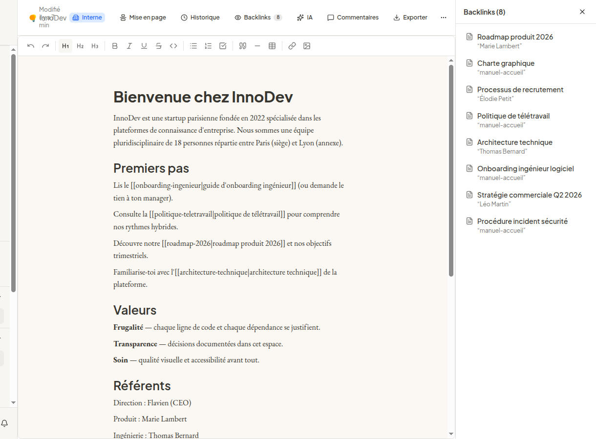
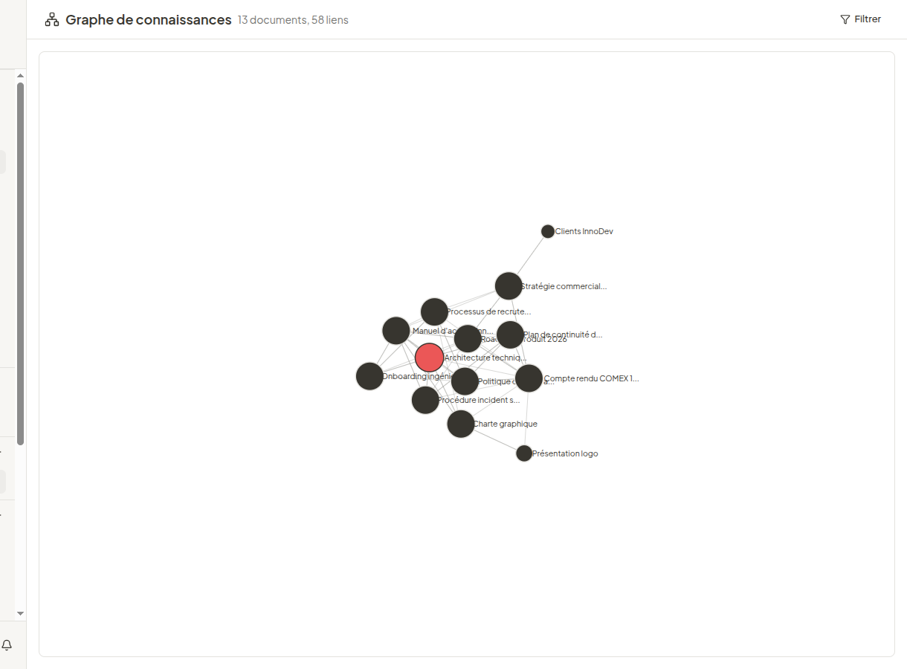
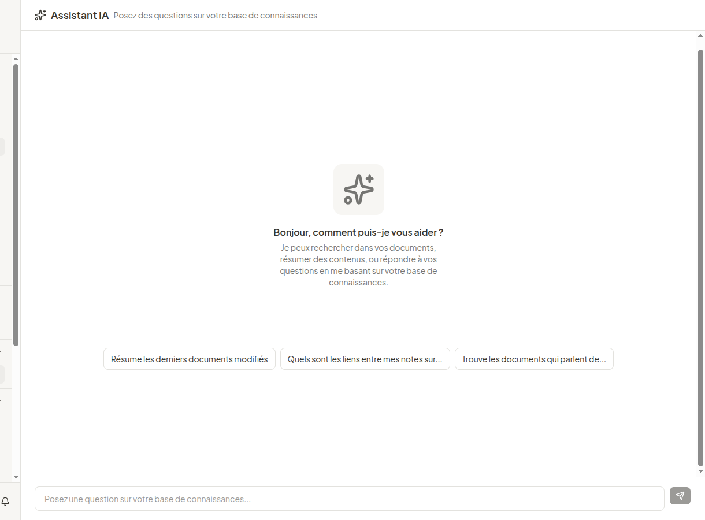

<div align="center">

# LorIAx

**Suite collaborative auto-hébergée type Notion/Obsidian, avec IA intégrée, pour les organismes qui veulent garder la main sur leurs données.**


[Fonctionnalités](#fonctionnalités) • [Démarrage](#démarrage-rapide) • [Déploiement](#déploiement) • [Architecture](#architecture) • [Stack](#stack-technique--dépendances-oss) • [Contribuer](#contribuer)

</div>

---

LorIAx est une plateforme de **gestion de connaissances et de productivité collaborative**, conçue pour les organismes qui veulent un Notion-like souverain et auto-hébergeable. Édition WYSIWYG temps réel, IA multi-provider, calendrier, visio, whiteboard, mindmap et bases de données : le tout dans une seule app cohérente. Cette édition open source est extraite du produit commercial de Studio Dragamig, publiée sous licence MIT.

> **Pour qui ?** Équipes, associations, collectivités, PME et services internes qui veulent un outil de productivité collaboratif **sans verrou cloud**, déployable sur leur propre infrastructure (VPS, on-premise, datacenter souverain).

## Aperçu

| Éditeur collaboratif avec backlinks | Graphe de connaissances |
|---|---|
|  |  |
| **Assistant IA contextuel (RAG)** | |
|  | |

*Captures recadrées depuis une instance de démonstration. La barre latérale d'origine a été retirée pour ne montrer que des fonctionnalités présentes dans cette édition open source.*

## Fonctionnalités

### Édition collaborative temps réel

- Éditeur WYSIWYG markdown avec slash-commands, mentions `@`, wiki-links `[[doc]]`, callouts, tables, code highlighting.
- Édition simultanée multi-curseur sans conflit (CRDT).
- Historique versionné de chaque document, navigation et diff visuel.
- Mode hors-ligne avec synchronisation différée à la reconnexion.

### Blocs riches

- Whiteboard infini, mindmaps, tableurs compatibles Excel, charts, cartes Leaflet.
- Bases de données type Notion (vues table, kanban, calendrier).
- Calendriers et réunions vidéo embarqués directement dans un document.

### IA multi-provider

- Chat contextuel sur vos documents, résumés, traductions, génération de blocs.
- Providers commutables : Claude, OpenAI, Mistral, Ollama (local).
- RAG sémantique sur votre base via embeddings vectoriels.
- Quotas par utilisateur / organisation, logs d'usage, prompts personnalisables.

### Graphe de connaissances

- Liens `[[document]]` automatiques avec backlinks.
- Visualisation interactive du graphe documentaire.
- Recherche full-text **et** sémantique.

### Calendrier & visio

- Serveur CalDAV intégré (synchronisable Apple Calendar, Thunderbird, DAVx⁵).
- Visioconférence self-host avec transcription audio automatique.
- Vues mois / semaine / jour / agenda, invitations, rappels.

### Multi-tenants & accès

- Authentification credentials, OAuth, LDAP.
- RBAC granulaire (super_admin, admin, editor, viewer).
- Multi-organisations avec permissions par espace.
- Partages publics révocables avec expiration.

### PWA & souveraineté

- Installable comme app native (Android, iOS, desktop).
- Stockage objet S3-compatible (Garage, MinIO, AWS, B2, …) ou filesystem.
- Sauvegardes automatiques planifiées.
- Webhooks sortants pour intégration externe.

## Architecture

```
                    ┌──────────────────────────────┐
                    │  Navigateur / PWA (React 19) │
                    └──────────────┬───────────────┘
                                   │ HTTPS + WebSocket
                                   ▼
        ┌──────────────────────────────────────────────────┐
        │  Reverse proxy (Caddy / Traefik / Nginx)         │
        └──────────────┬─────────────────────┬─────────────┘
                       │                     │
                       ▼                     ▼ /ws/collab
        ┌──────────────────────────┐  ┌───────────────────┐
        │  Next.js 16 App Router   │  │  Hocuspocus       │
        │  + API routes + RBAC     │  │  (Yjs CRDT WS)    │
        │  + RAG + IA orchestration│  └─────────┬─────────┘
        └────┬─────────┬──────┬────┘            │
             │         │      │                 │
             ▼         ▼      ▼                 ▼
       ┌──────────┐ ┌─────┐ ┌─────────┐  ┌──────────────┐
       │ Postgres │ │ S3  │ │ LLM     │  │ Doc states   │
       │ pgvector │ │     │ │ provider│  │ (Yjs binary) │
       │ pg_trgm  │ │ Gar.│ │ Claude/ │  └──────────────┘
       └──────────┘ │MinIO│ │ OpenAI/ │
                    │ AWS │ │ Ollama  │
                    └─────┘ └─────────┘
                       ▲
                       │
                   ┌───┴────┐
                   │LiveKit │  (visio + transcription Whisper/Voxtral)
                   └────────┘
```

Trois plans d'exécution dans un seul process Node :

1. **HTTP/REST** : Next.js App Router (routes UI + `/api/*`).
2. **WebSocket collab** : Hocuspocus sur `/ws/collab`, sauvegarde des `Y.Doc` dans Postgres.
3. **Workers** : schedulers croner (backups, télémétrie, purges).

## Stack technique & dépendances OSS

La quasi-totalité de la stack est sous licence libre au sens OSI. Seule exception : `react-leaflet` est distribué sous licence Hippocratic 2.1, une licence source-available à clause éthique, non approuvée par l'OSI. Chaque outil est listé avec sa licence d'origine, conformément à l'esprit OSS.

### Frontend

| Outil | Version | Licence | Rôle |
|---|---|---|---|
| [Next.js](https://nextjs.org) | 16 | MIT | Framework React + serveur custom |
| [React](https://react.dev) | 19 | MIT | UI |
| [TypeScript](https://www.typescriptlang.org) | 6 | Apache-2.0 | Typage statique |
| [Tailwind CSS](https://tailwindcss.com) | 4 | MIT | Styling utility-first |
| [shadcn/ui](https://ui.shadcn.com) + [@base-ui/react](https://base-ui.com) | 1.3 | MIT | Composants accessibles |
| [TipTap](https://tiptap.dev) | 3 | MIT | Éditeur WYSIWYG headless |
| [Yjs](https://yjs.dev) | 13 | MIT | CRDT collaboration temps réel |
| [Excalidraw](https://excalidraw.com) | 0.18 | MIT | Whiteboard |
| [Mind Elixir](https://mind-elixir.com) | 5 | MIT | Mindmaps |
| [Univer](https://univer.ai) | 0.19 | Apache-2.0 | Tableur compatible Excel |
| [Recharts](https://recharts.org) | 3 | MIT | Visualisations |
| [Leaflet](https://leafletjs.com) + react-leaflet | 1.9 / 5 | BSD-2 / Hippocratic 2.1 (non OSI) | Cartes |
| [Lucide](https://lucide.dev) | 0.577 | ISC | Icônes |
| [Sonner](https://sonner.emilkowal.ski) | 2 | MIT | Toasts |
| [cmdk](https://cmdk.paco.me) | 1 | MIT | Command palette |
| [@dnd-kit](https://dndkit.com) | 6 | MIT | Drag & drop |
| [Serwist](https://serwist.pages.dev) | 9 | BSD-3 | Service Worker / PWA |
| [VizHash GD](https://sebsauvage.net/wiki/doku.php?id=php:vizhash_gd_source) (portage TS) | n/a | Zlib / libre | Avatars visuels déterministes (algorithme original de [Seb Sauvage](https://sebsauvage.net)) |

### Backend

| Outil | Licence | Rôle |
|---|---|---|
| [Drizzle ORM](https://orm.drizzle.team) + drizzle-kit | Apache-2.0 | ORM SQL typé + migrations |
| [PostgreSQL](https://www.postgresql.org) | PostgreSQL | Base de données |
| [pgvector](https://github.com/pgvector/pgvector) | PostgreSQL | Embeddings vectoriels |
| [pg_trgm](https://www.postgresql.org/docs/current/pgtrgm.html) | PostgreSQL | Recherche fuzzy |
| [NextAuth v5](https://authjs.dev) | ISC | Authentification |
| [ldapjs](https://github.com/ldapjs/node-ldapjs) | MIT | Connecteur LDAP |
| [jose](https://github.com/panva/jose) | MIT | JWT / JWS / JWE |
| [bcryptjs](https://github.com/dcodeIO/bcrypt.js) | MIT | Hash de mots de passe |
| [Zod](https://zod.dev) | MIT | Validation runtime |
| [Hocuspocus](https://tiptap.dev/hocuspocus) | MIT | Serveur collab Yjs |
| [Vercel AI SDK](https://sdk.vercel.ai) | Apache-2.0 | Abstraction LLM multi-provider |
| [Ollama](https://ollama.com) (client) | MIT | LLM locaux |
| [isomorphic-git](https://isomorphic-git.org) | MIT | Versioning Git pur JS |
| [croner](https://github.com/Hexagon/croner) | MIT | Scheduler |
| [pino](https://getpino.io) | MIT | Logger structuré |
| [ioredis](https://github.com/redis/ioredis) | MIT | Client Redis |
| [nodemailer](https://nodemailer.com) / [resend](https://resend.com) | MIT | Envoi d'emails |
| [Sharp](https://sharp.pixelplumbing.com) | Apache-2.0 | Traitement d'images |
| [FFmpeg](https://ffmpeg.org) (`@ffmpeg/ffmpeg`) | LGPL-2.1 | Traitement audio/vidéo |
| [LiveKit](https://livekit.io) (server-sdk) | Apache-2.0 | Visio WebRTC |
| [Whisper](https://github.com/openai/whisper) / [Voxtral](https://mistral.ai/news/voxtral) | MIT / Apache-2.0 | Transcription audio |

### Qualité & tests

| Outil | Licence | Rôle |
|---|---|---|
| [Vitest](https://vitest.dev) | MIT | Tests unitaires |
| [Playwright](https://playwright.dev) | Apache-2.0 | Tests end-to-end |
| [ESLint](https://eslint.org) + eslint-config-next | MIT | Lint |
| [@testing-library/react](https://testing-library.com) | MIT | Test composants |

### Infrastructure

| Outil | Licence | Rôle |
|---|---|---|
| [Docker](https://www.docker.com) / [Docker Compose](https://docs.docker.com/compose/) | Apache-2.0 | Conteneurisation |
| [Garage](https://garagehq.deuxfleurs.fr) | AGPL-3.0 | Stockage objet S3 distribué auto-hébergé (recommandé) |
| [Traefik](https://traefik.io) / [Caddy](https://caddyserver.com) / [Nginx](https://nginx.org) | MIT / Apache-2.0 / BSD-2 | Reverse proxy au choix |

Liste exhaustive et licences dans [`NOTICE.md`](./NOTICE.md) et `package.json`.

## Démarrage rapide

### Prérequis

- **Node.js ≥ 20** (Node 22 recommandé, `.nvmrc` fourni, [nvm](https://github.com/nvm-sh/nvm) conseillé)
- **Docker ≥ 24** + Docker Compose v2 (fournit PostgreSQL, Garage S3 et Ollama en local)

### Installation en une commande

```bash
git clone https://github.com/Flavien-Dragamig/lorIAx-oss.git
cd lorIAx-oss
npm run dev:full
```

`npm run dev:full` fait tout : vérifie les prérequis, crée `.env.local` depuis `.env.example` (secrets générés automatiquement), installe les dépendances, démarre PostgreSQL + Garage + Ollama via Docker, applique le schéma, seed les comptes de dev et lance le serveur. Arrêt avec `npm run dev:stop`.

### Installation manuelle (pas à pas)

```bash
git clone https://github.com/Flavien-Dragamig/lorIAx-oss.git
cd lorIAx-oss
bash scripts/generate-env.sh > .env.local   # secrets générés (voir Configuration)
npm install
docker compose up -d postgres garage garage-init   # dépendances (BDD + S3)
npm run db:fresh                  # reset + migrations + comptes de démo + templates
npm run dev
```

Sans Docker, il faut fournir un PostgreSQL 16 avec les extensions `pgvector` et `pg_trgm`, et ajuster `DATABASE_URL` dans `.env.local`.

App accessible sur **http://localhost:3000**.

Comptes de démo (à changer avant tout déploiement public) :

| Email | Mot de passe | Rôle |
|---|---|---|
| `admin@loriax.dev` | `admin123` | super_admin |
| `user@loriax.dev` | `user123` | editor |

### Première configuration : la clé d'installation

L'assistant de configuration (`/setup`) crée le premier super administrateur : il n'est
donc pas ouvert au premier visiteur venu. Sur une instance encore vide, il réclame une
**clé d'installation**. Deux façons de l'obtenir.

**Option 1, recommandée en production : la fixer vous-même.** Renseignez
`SETUP_INSTALL_TOKEN` (16 caractères minimum) avant le premier démarrage. Elle n'est
alors ni générée, ni stockée en base, ni écrite dans les journaux, et l'installation
devient automatisable.

```bash
openssl rand -base64 32          # la valeur à mettre dans SETUP_INSTALL_TOKEN
```

**Option 2 : la laisser générer.** Sans cette variable, le serveur en crée une au
premier affichage de `/setup` et l'écrit dans ses journaux, au niveau `warn`, avec le
message `Jeton d'installation de cette instance`. En production les journaux sont au
format NDJSON : la clé est la fin du champ `msg`.

```bash
# installation via install.sh
docker compose -f docker-compose.client.yml logs app | grep "Jeton d'installation"
# stack docker-compose.yml
docker compose logs app | grep "Jeton d'installation"
```

Collez la clé dans l'assistant, puis déroulez les étapes. Une clé générée est supprimée
de la base dès que la configuration est terminée ou reportée ; une clé fournie par
`SETUP_INSTALL_TOKEN` cesse simplement d'être acceptée, l'assistant étant clos. Sur une
instance déjà en service, aucune clé n'est nécessaire : il suffit d'être connecté avec
un compte `super_admin`.

## Configuration

Toutes les variables d'environnement sont documentées dans [`.env.example`](./.env.example), qui fait office de source de vérité.

Sous-ensemble essentiel :

| Variable | Côté | Description |
|---|---|---|
| `DATABASE_URL` | serveur | URL PostgreSQL (pgvector + pg_trgm requis) |
| `NEXTAUTH_SECRET` | serveur | Secret de signature des sessions (`openssl rand -base64 32`) |
| `NEXTAUTH_URL` | serveur | URL publique pour les redirections OAuth |
| `ENCRYPTION_KEY` | serveur | Clé 32 octets base64 chiffrant en base les secrets IA, LDAP, SMTP et sauvegarde (`openssl rand -base64 32`) |
| `SETUP_INSTALL_TOKEN` | serveur | Clé d'accès à l'assistant `/setup` (optionnel, sinon générée et journalisée au premier affichage) |
| `NEXT_PUBLIC_APP_URL` | client+serveur | URL publique (emails, webhooks, QR codes) |
| `S3_ENDPOINT`, `S3_BUCKET`, `S3_ACCESS_KEY`, `S3_SECRET_KEY` | serveur | Stockage objet (optionnel, filesystem par défaut) |
| `ANTHROPIC_API_KEY` / `OPENAI_API_KEY` / `MISTRAL_API_KEY` / `OLLAMA_HOST` | serveur | Providers IA (optionnels, configurables aussi en runtime via l'admin) |
| `LIVEKIT_URL`, `LIVEKIT_API_KEY`, `LIVEKIT_API_SECRET` | serveur | Visio (optionnel) |
| `LDAP_URL`, `LDAP_BIND_DN`, `LDAP_BIND_CREDENTIALS`, `LDAP_SEARCH_BASE` | serveur | Annuaire (optionnel) |

> ⚠️ Ne **jamais** committer un `.env` rempli. Seul `.env.example` doit être versionné.

## Déploiement

### Build de production

```bash
npm run build
npm start    # Next.js + serveur WebSocket collaboration
```

### Docker Compose (recommandé)

Stack tout-en-un : app + PostgreSQL (pgvector) + Garage (S3) + Ollama + backup planifié.

```bash
bash scripts/generate-env.sh > .env.local   # secrets générés, puis ajuster les URLs
docker compose up -d
```

`.env.example` documente les variables mais ne contient **aucune** valeur de secret :
`NEXTAUTH_SECRET` et `ENCRYPTION_KEY` y sont vides, et l'application refuse de démarrer
tant qu'ils ne sont pas renseignés. `scripts/generate-env.sh` les tire pour vous.

Variantes fournies à la racine :

| Fichier | Usage |
|---|---|
| `docker-compose.yml` | Dev local tout-en-un |
| `docker-compose.prod.yml` | Production avec Traefik et healthchecks renforcés |
| `docker-compose.livekit.yml` | Ajout de la stack LiveKit (visio) |
| `docker-compose.registry.yml` | Pull depuis un registry privé (GHCR par défaut) |
| `docker/docker-compose.dev.yml` | Overlay de `docker/docker-compose.yml` : dépendances seules (BDD + S3, ports exposés, app désactivée), pour itérer en `npm run dev`. Usage : `docker compose -f docker/docker-compose.yml -f docker/docker-compose.dev.yml up -d` |

### PaaS self-host (Dokploy, Coolify, Easypanel)

Le `Dockerfile` est compatible. Configurer :

- **Build** : Dockerfile
- **Port exposé** : `3000` (HTTP **et** WS upgrade sur `/ws/collab`)
- **Variables** : voir `.env.example`
- **Volumes** : `/app/workspaces` (documents), migrations bundlées dans l'image
- **Healthcheck** : `GET /api/health`

### Reverse proxy

Exemple Caddy minimal :

```caddyfile
loriax.example.com {
    reverse_proxy localhost:3000
}
```

Caddy gère automatiquement l'upgrade WebSocket. Pour Nginx, ajouter `proxy_set_header Upgrade $http_upgrade;` et `proxy_set_header Connection "upgrade";` sur `/ws/collab`.

### Migrations & sauvegardes

- Migrations Drizzle exécutées **automatiquement** au démarrage par `server.ts`.
- Sauvegardes : service `backup` du compose (`pg_dump` quotidien + snapshot S3), réglable via `BACKUP_SCHEDULE` et `BACKUP_RETENTION_DAYS`.

## Scripts npm

| Commande | Effet |
|---|---|
| `npm run dev` | Serveur Next.js + WebSocket en mode dev (tsx watch) |
| `npm run dev:full` | Stack complète (Docker + BDD + seed + serveur) |
| `npm run dev:stop` | Arrête la stack `dev:full` |
| `npm run build` | Build production Next.js |
| `npm start` | Démarre `server.js` compilé en production |
| `npm run lint` | ESLint |
| `npm test` | Vitest (tests unitaires) |
| `npm run test:e2e` | Playwright (end-to-end) |
| `npm run db:fresh` | Reset BDD + migrations + seed (dev users, base, démo) |
| `npm run db:reset` | Reset BDD seul |
| `npm run db:seed`, `db:seed:base`, `db:seed:templates`, `db:seed:ai-prompts`, `db:seed:demo` | Seeds ciblés |
| `npm run db:generate` | Génère une nouvelle migration depuis le schéma |
| `npm run db:migrate` | Applique les migrations manuellement |
| `npm run db:push` | Sync schéma direct (dev uniquement, sans migration) |
| `npm run db:studio` | Lance Drizzle Studio (UI BDD) |
| `npm run db:migrate:fts` | Applique les triggers de recherche full-text |

## Structure du projet

```
.
├── server.ts                  # Serveur custom (Next + Hocuspocus + crons)
├── src/
│   ├── app/                   # Next.js App Router
│   │   ├── (auth)/            # Login, register, reset password
│   │   ├── (app)/             # App principale (avec sidebar)
│   │   └── api/               # Route handlers REST + v1 publique
│   ├── components/            # React
│   │   ├── ui/                # shadcn/ui primitives
│   │   ├── editor/            # TipTap + extensions custom
│   │   ├── graph/             # Visualisation D3 du graphe
│   │   ├── sidebar/           # Navigation
│   │   └── ai/                # Chat IA, résumé
│   ├── lib/                   # Logique métier
│   │   ├── db/                # Schéma Drizzle, client, migrations
│   │   ├── auth/              # NextAuth + RBAC + LDAP
│   │   ├── collab/            # Hocuspocus + Yjs
│   │   ├── storage/           # S3 (Garage) + filesystem
│   │   ├── git/               # isomorphic-git
│   │   ├── ai/                # Providers + RAG
│   │   ├── editor/            # Conversion MD ↔ TipTap
│   │   └── security/          # SSRF, rate-limit, URL validation
│   ├── hooks/                 # Hooks React custom
│   └── types/                 # Types TypeScript partagés
├── scripts/                   # Seeds, migrations FTS, dev helpers
├── docker/                    # Compose dev + sous-stacks (Garage, LiveKit, Voxtral)
├── docker-compose*.yml        # Variantes d'orchestration
├── Dockerfile
├── drizzle.config.ts
└── .env.example               # Source de vérité config
```

## Tests & qualité

```bash
npm test            # Vitest (unitaires + intégration)
npm run test:e2e    # Playwright (parcours bout-en-bout)
npm run lint        # ESLint
npx tsc --noEmit    # Vérification TypeScript stricte
```

Couverture chiffrée pas encore publiée ; contributions bienvenues sur les chemins critiques (auth, RBAC, collab, RAG).

## Contribuer

Lire [`CONTRIBUTING.md`](./CONTRIBUTING.md). Conventions :

- **Conventional Commits** obligatoires (`feat:`, `fix:`, `chore:`, `docs:`, `refactor:`, `test:`, `perf:`).
- TypeScript strict, alias `@/` pour `src/`.
- Frugalité : pas de SaaS externe imposé, peu de dépendances lourdes.
- UI en français, code en anglais.

Bugs et propositions : [GitHub Issues](https://github.com/Flavien-Dragamig/lorIAx-oss/issues).

## Sécurité

La politique de divulgation responsable est décrite dans [`SECURITY.md`](./SECURITY.md). En résumé : signaler toute vulnérabilité à `security@dragamig.fr` et **ne pas** ouvrir d'issue publique pour les failles non encore corrigées.

L'app applique par défaut : CSP avec nonce, protection SSRF sur les URLs entrantes, rate-limiting, classification de documents, et hash bcrypt des mots de passe.

## Changelog

Voir [`CHANGELOG.md`](./CHANGELOG.md). Le projet suit [SemVer](https://semver.org/lang/fr/) et [Conventional Commits](https://www.conventionalcommits.org/fr/).

## À propos

> **Créé par [Studio Dragamig](https://dragamig.fr) avec l'aide de [Claude d'Anthropic](https://www.anthropic.com/claude).**

[Studio Dragamig](https://dragamig.fr) est un studio indépendant français qui conçoit des outils numériques souverains pour les organismes engagés. LorIAx est notre suite collaborative phare, dont nous publions ici l'édition open source.

L'usage de Claude (Anthropic) intervient en assistance à la conception, à la documentation et à la maintenance, **toujours sous supervision humaine** : les choix d'architecture, de produit, de sécurité et de licensing restent ceux de Studio Dragamig.

## Remerciements

- **[Seb Sauvage](https://sebsauvage.net)** pour [VizHash GD](https://sebsauvage.net/wiki/doku.php?id=php:vizhash_gd_source), dont nous utilisons un portage TypeScript pour générer les avatars visuels déterministes des utilisateurs.
- **[Deuxfleurs](https://deuxfleurs.fr)** pour [Garage](https://garagehq.deuxfleurs.fr), le stockage objet souverain.
- **[Kevin Jahns](https://github.com/dmonad)** pour Yjs, l'épine dorsale de la collaboration temps réel.
- **[L'équipe TipTap](https://tiptap.dev)** pour l'éditeur le plus modulaire de l'écosystème.
- **[LiveKit](https://livekit.io)** pour avoir rendu la visio WebRTC self-host accessible.
- **[Drizzle Team](https://orm.drizzle.team)** pour l'ORM SQL le plus agréable de l'écosystème Node.
- **[Andrew Kane](https://github.com/ankane)** pour pgvector.
- Toute la communauté **shadcn/ui** et **Tailwind**.
- Et l'ensemble des mainteneurs OSS listés dans [`NOTICE.md`](./NOTICE.md) : sans vous, ce projet n'existerait pas.

## Licence

[MIT](./LICENSE), Copyright © 2026 Dragamig SAS (Studio Dragamig).

Vous êtes libre d'utiliser, modifier, redistribuer et commercialiser ce logiciel, y compris dans un produit fermé, à condition de préserver la notice de copyright et de licence. Aucune garantie n'est fournie.
